# Performance Analysis - API Call Tracing

## ⚠️ IMPORTANT: Read Risk Assessment First

**Before implementing any optimizations, review [PERFORMANCE_RISKS.md](./PERFORMANCE_RISKS.md)** for:
- Breaking changes and disruption risks
- Safe implementation strategies
- Testing requirements
- Rollback plans

## Overview
This document traces all API calls made during page load and identifies redundant calls, bottlenecks, and optimization opportunities.

## API Calls During Page Load

### 1. PortfolioDashboard Component (Main Entry Point)
**File**: `src/components/Dashboard/PortfolioDashboard.jsx`

**On Mount**:
- `GET /api/portfolio` - Fetches portfolio summary and holdings
  - **Timing**: Called once on mount
  - **DynamoDB Operations**: 
    - 1x `scan()` on `PortfolioSnapshots` table (inefficient - scans entire table)
    - 1x `scan()` on `Holdings` table with FilterExpression (inefficient - scans entire table)
  - **Impact**: Medium - Two full table scans

### 2. SecuritiesList Component
**File**: `src/components/Dashboard/SecuritiesList.jsx`

**On Mount + Polling**:
- `GET /api/quotes?symbols=<111+ symbols>` - Fetches prices for all securities
  - **Timing**: 
    - Called immediately on mount
    - Polls every 8 seconds thereafter
  - **Processing**: 
    - Sequential batch processing (5 symbols per batch)
    - 100ms delay between each symbol
    - 200ms delay between batches
    - **Estimated time**: 15-20 seconds for 111 symbols
  - **Impact**: **CRITICAL** - This is the main bottleneck
  - **Redundancy**: Called repeatedly every 8 seconds even if data hasn't changed

### 3. USDMacroDashboard Component
**File**: `src/components/Dashboard/USDMacroDashboard.jsx`

**On Mount + Refresh Interval**:
- `GET /api/usd/dxy` - Fetches DXY value
- `GET /api/usd/currency-pairs` - Fetches currency pairs (mock data)
- `GET /api/usd/correlations` - Fetches USD correlations
  - **Timing**: 
    - All called in parallel via `Promise.all()` on mount
    - Refreshes every `REFRESH_INTERVALS.DASHBOARD` (check constant)
  - **DynamoDB Operations**:
    - 1x `query()` on `MarketPriceHistory` for DXY (efficient)
    - 1x `scan()` on `USDCorrelations` table (inefficient)
  - **Impact**: Medium - One scan operation

### 4. FXLayoutsShowcase Component
**File**: `src/components/Dashboard/FXLayoutsShowcase.jsx`

**On Mount**:
- Multiple `GET /api/usd/historical?symbol=<pair>&days=30` calls
  - **Timing**: Called once on mount for each currency pair
  - **Pairs Fetched**: 
    - DXY
    - All currency pairs from `currencyPairs` prop
    - UUP
    - Currency index ETFs
  - **Estimated Calls**: 10-15 historical data requests
  - **DynamoDB Operations**: 
    - 1x `query()` per symbol on `MarketPriceHistory` (efficient, but many calls)
    - Fallback to Yahoo Finance API if no DB data
  - **Impact**: Medium-High - Many parallel requests, but each is relatively fast

### 5. USDProxies Component
**File**: `src/components/Dashboard/USDProxies.jsx`

**On Mount**:
- Multiple `GET /api/usd/historical?symbol=<pair>&days=365` calls
  - **Timing**: Called once on mount
  - **Pairs Fetched**: All currency pairs + currency indexes
  - **Days**: Always fetches 365 days regardless of view
  - **Estimated Calls**: 10-15 historical data requests
  - **Impact**: Medium - Fetches more data than needed

### 6. VolumePanel Component
**File**: `src/components/Dashboard/VolumePanel.jsx`

**On Ticker Selection**:
- `GET /api/usd/historical?symbol=<ticker>&days=365` - Fetches 365 days of data
- `GET /api/risk-ranges?tickers=<ticker>` - Fetches risk ranges
  - **Timing**: Called when user selects a ticker
  - **Days**: Always fetches 365 days regardless of selected timeframe
  - **DynamoDB Operations**:
    - 1x `query()` on `MarketPriceHistory` (efficient)
    - 1x `get()` on `RiskRangeData` table (efficient)
  - **Impact**: Low-Medium - Fetches more data than needed

### 7. WorkflowStatus Component
**File**: `src/components/Dashboard/WorkflowStatus.jsx`

**On Mount**:
- `GET /api/workflow-status` - Fetches workflow status
- `GET /api/risk-ranges` - Fetches all risk ranges
  - **Timing**: Called once on mount
  - **DynamoDB Operations**:
    - 1x `get()` on `HedgeyeDailySnapshot` (efficient)
    - 1x `scan()` on `HedgeyeDailySnapshot` if today's data not found (inefficient)
    - 1x `scan()` on `PortfolioSnapshots` (inefficient)
    - 1x `get()` on `RiskRangeData` (efficient)
  - **Impact**: Medium - Two scan operations

### 8. StaticMetricBar Component
**File**: `src/components/Dashboard/StaticMetricBar.jsx`

**On Mount**:
- `GET /api/macro-indicators` - Fetches macro indicators (DXY, GLD, UST10Y, CRB, WTI, SPY, QQQ, IWM)
  - **Timing**: Called once on mount
  - **Processing**: 
    - Sequential batch processing (5 symbols per batch)
    - 100ms delay between each symbol
    - 200ms delay between batches
    - **Estimated time**: 1-2 seconds for 8 symbols
  - **Impact**: Low-Medium - Small batch, but still sequential

### 9. PerformanceTracking Component
**File**: `src/components/Dashboard/PerformanceTracking.jsx`

**On Mount** (if visible):
- `GET /api/performance/equity-curve`
- `GET /api/performance/metrics`
- `GET /api/performance/history`
- `GET /api/performance/benchmark`
- `GET /api/performance/statements`
  - **Timing**: Called in parallel via `Promise.all()` when component mounts
  - **Impact**: Low - Only called if panel is opened

## Redundant API Calls Identified

### 1. Quotes Endpoint - Multiple Redundant Calls
- **SecuritiesList**: Calls `/api/quotes` with 111+ symbols every 8 seconds
- **StaticMetricBar**: Calls `/api/macro-indicators` which internally calls `getQuote()` for 8 symbols
- **Redundancy**: SPY, QQQ are fetched by both endpoints
- **Impact**: High - Duplicate processing of same symbols

### 2. Historical Data - Excessive Fetching
- **USDProxies**: Fetches 365 days for all pairs on mount
- **FXLayoutsShowcase**: Fetches 30 days for all pairs on mount
- **VolumePanel**: Fetches 365 days when ticker selected
- **Redundancy**: Same pairs fetched multiple times with different day ranges
- **Impact**: Medium - Unnecessary data transfer

### 3. Risk Ranges - Duplicate Calls
- **WorkflowStatus**: Calls `/api/risk-ranges` on mount
- **VolumePanel**: Calls `/api/risk-ranges` when ticker selected
- **Redundancy**: Risk ranges fetched multiple times
- **Impact**: Low - Risk ranges are cached in DynamoDB, but still redundant

### 4. Portfolio Data - Redundant Scans
- **PortfolioDashboard**: Scans entire `PortfolioSnapshots` table
- **WorkflowStatus**: Also scans `PortfolioSnapshots` table
- **Redundancy**: Same table scanned twice
- **Impact**: Medium - Two full table scans

## DynamoDB Operation Analysis

### Scan Operations (Inefficient)
1. **PortfolioSnapshots** - Scanned twice:
   - `/api/portfolio` - Full scan
   - `/api/workflow-status` - Full scan with Limit: 10
   
2. **HedgeyeDailySnapshot** - Scanned once:
   - `/api/workflow-status` - Scan with FilterExpression if today's data not found
   
3. **MarketPriceHistory** - Scanned once:
   - `/api/securities/signal-strength` - Full scan with ProjectionExpression: 'symbol'
   
4. **Holdings** - Scanned once:
   - `/api/portfolio` - Scan with FilterExpression: 'snapshotId = :snapshotId'
   
5. **USDCorrelations** - Scanned once:
   - `/api/usd/correlations` - Scan with Limit: 1

### Query Operations (Efficient)
1. **MarketPriceHistory** - Queried multiple times:
   - `/api/usd/dxy` - Query by symbol
   - `/api/usd/historical` - Query by symbol and date range
   - `/api/securities/signal-strength` - Query by symbol (after scan)

### Get Operations (Efficient)
1. **RiskRangeData** - Get once:
   - `/api/risk-ranges` - Get by key
   
2. **HedgeyeDailySnapshot** - Get once:
   - `/api/workflow-status` - Get by date and snapshotType

## Performance Bottlenecks Summary

### Critical Issues
1. **Sequential Quote Processing**: 15-20 seconds for 111 symbols
   - Location: `/api/quotes` endpoint
   - Impact: Blocks all quote requests
   - Solution: Parallelize requests

2. **Aggressive Polling**: Every 8 seconds for 111+ symbols
   - Location: `SecuritiesList` component
   - Impact: Constant server load
   - Solution: Increase interval or use WebSockets

### High Priority Issues
3. **Multiple Table Scans**: 5 scan operations on page load
   - Impact: Slow database queries
   - Solution: Use indexes and queries instead of scans

4. **Redundant API Calls**: Same data fetched multiple times
   - Impact: Unnecessary network and processing overhead
   - Solution: Implement request deduplication and caching

### Medium Priority Issues
5. **Excessive Historical Data**: Always fetching 365 days
   - Impact: Unnecessary data transfer
   - Solution: Fetch only what's needed based on view

6. **No Response Caching**: Historical data, risk ranges, portfolio data not cached
   - Impact: Repeated fetches of same data
   - Solution: Add caching layer

## DynamoDB Operation Analysis

### Scan Operations (Inefficient - Need Optimization)

#### 1. PortfolioSnapshots Table
**Location**: `/api/portfolio` (line 1278) and `/api/workflow-status` (line 735)

**Current Operation**:
```javascript
// /api/portfolio - Full table scan
const snapshotParams = { TableName: 'PortfolioSnapshots' };
const snapshotResult = await dynamodb.scan(snapshotParams).promise();

// /api/workflow-status - Full table scan with Limit
const portfolioParams = {
  TableName: 'PortfolioSnapshots',
  Limit: 10
};
const portfolioResult = await dynamodb.scan(portfolioParams).promise();
```

**Purpose**: Get latest portfolio snapshot (sorted by timestamp descending)

**Problem**: 
- Scans entire table to find latest snapshot
- No index on `timestamp` field
- Called twice (once in each endpoint)

**Solution**: 
- Create GSI: `timestamp-index` with `timestamp` as partition key
- Query: `query()` on GSI with `ScanIndexForward: false, Limit: 1`
- **Impact**: O(1) query instead of O(n) scan

**Index Definition**:
```javascript
{
  IndexName: 'timestamp-index',
  KeySchema: [
    { AttributeName: 'timestamp', KeyType: 'HASH' }
  ],
  Projection: { ProjectionType: 'ALL' }
}
```

#### 2. Holdings Table
**Location**: `/api/portfolio` (line 1319)

**Current Operation**:
```javascript
const holdingsParams = {
  TableName: 'Holdings',
  FilterExpression: 'snapshotId = :snapshotId',
  ExpressionAttributeValues: {
    ':snapshotId': snapshotId
  }
};
const holdingsResult = await dynamodb.scan(holdingsParams).promise();
```

**Purpose**: Get all holdings for a specific snapshot

**Problem**: 
- Scans entire table with FilterExpression
- No index on `snapshotId` field
- FilterExpression is applied after scan (inefficient)

**Solution**: 
- Create GSI: `snapshotId-index` with `snapshotId` as partition key
- Query: `query()` on GSI with `snapshotId = :snapshotId`
- **Impact**: O(1) query instead of O(n) scan

**Index Definition**:
```javascript
{
  IndexName: 'snapshotId-index',
  KeySchema: [
    { AttributeName: 'snapshotId', KeyType: 'HASH' }
  ],
  Projection: { ProjectionType: 'ALL' }
}
```

#### 3. HedgeyeDailySnapshot Table
**Location**: `/api/workflow-status` (line 698)

**Current Operation**:
```javascript
const scanParams = {
  TableName: 'HedgeyeDailySnapshot',
  FilterExpression: 'snapshotType = :type',
  ExpressionAttributeValues: {
    ':type': 'risk-ranges'
  },
  Limit: 10
};
const recentSnapshot = await dynamodb.scan(scanParams).promise();
```

**Purpose**: Find most recent snapshot if today's data not found

**Problem**: 
- Scans table with FilterExpression on sort key
- FilterExpression applied after scan
- Only used as fallback, but still inefficient

**Solution**: 
- Primary key already has `snapshotType` as sort key
- Use `query()` with `date` partition key and `snapshotType` sort key
- Query recent dates in descending order
- **Impact**: O(1) query instead of O(n) scan

**Optimized Query**:
```javascript
// Query recent dates (last 10 days) in descending order
const dates = Array.from({ length: 10 }, (_, i) => {
  const date = new Date();
  date.setDate(date.getDate() - i);
  return date.toISOString().split('T')[0];
});

// Try each date until we find one with risk-ranges
for (const date of dates) {
  const params = {
    TableName: 'HedgeyeDailySnapshot',
    KeyConditionExpression: 'date = :date AND snapshotType = :type',
    ExpressionAttributeValues: {
      ':date': date,
      ':type': 'risk-ranges'
    }
  };
  const result = await dynamodb.query(params).promise();
  if (result.Items.length > 0) {
    return result.Items[0];
  }
}
```

#### 4. MarketPriceHistory Table
**Location**: `/api/securities/signal-strength` (line 1154)

**Current Operation**:
```javascript
const scanParams = {
  TableName: 'MarketPriceHistory',
  ProjectionExpression: 'symbol'
};
const scanResult = await dynamodb.scan(scanParams).promise();
const uniqueSymbols = [...new Set(scanResult.Items.map(item => item.symbol))];
```

**Purpose**: Get all unique symbols from table

**Problem**: 
- Scans entire table to get unique symbols
- Very inefficient for large tables
- Only needs symbol list, not full data

**Solution**: 
- Maintain a separate `Symbols` table or cache
- Or create a sparse GSI with `symbol` as partition key
- Or query distinct symbols from application layer cache
- **Impact**: Avoid scan entirely

**Alternative Solution**: 
- Store symbol list in separate table: `SymbolList` with single item
- Update when new symbols added
- Query: `get()` on `SymbolList` table

#### 5. USDCorrelations Table
**Location**: `/api/usd/correlations` (line 1502)

**Current Operation**:
```javascript
const params = {
  TableName: 'USDCorrelations',
  ScanIndexForward: false,
  Limit: 1
};
const result = await dynamodb.scan(params).promise();
```

**Purpose**: Get latest correlation data

**Problem**: 
- Scans entire table to get latest item
- No sort key, so can't query by date efficiently
- Only needs most recent calculation

**Solution**: 
- Add sort key: `timestamp` or `calculationDate`
- Query: `query()` with partition key and sort key descending
- **Impact**: O(1) query instead of O(n) scan

**Note**: Table schema shows `calculationDate` as partition key, but scan is still used. This suggests the table might need restructuring or the code needs to use `query()` instead.

### Query Operations (Efficient - Already Optimized)

#### 1. MarketPriceHistory Table
**Locations**: 
- `/api/usd/dxy` (line 1437) - Query by symbol
- `/api/usd/historical` (line 1600) - Query by symbol and date range
- `/api/securities/signal-strength` (line 1183) - Query by symbol

**Status**: ✅ Efficient - Uses primary key queries

#### 2. RiskRangeData Table
**Location**: `/api/risk-ranges` (line 608)

**Status**: ✅ Efficient - Uses `get()` operation with primary key

#### 3. HedgeyeDailySnapshot Table
**Location**: `/api/workflow-status` (line 673), `/api/hedgeye/screenshot` (line 788), `/api/hedgeye/csv` (line 834)

**Status**: ✅ Efficient - Uses `get()` with primary key

### Get Operations (Efficient - Already Optimized)

All `get()` operations are efficient:
- `/api/risk-ranges` - Get by primary key
- `/api/workflow-status` - Get by primary key
- `/api/notes/:date` - Get by primary key
- `/api/notes/calendar/:date` - Get by primary key

## Missing Indexes Summary

| Table | Missing Index | Purpose | Impact |
|-------|---------------|---------|--------|
| PortfolioSnapshots | `timestamp-index` (GSI) | Get latest snapshot | High - Used in 2 endpoints |
| Holdings | `snapshotId-index` (GSI) | Get holdings by snapshot | High - Used in portfolio endpoint |
| HedgeyeDailySnapshot | Already has proper keys | Query by date+type | Medium - Code needs optimization |
| MarketPriceHistory | Symbol list cache | Get unique symbols | Medium - Used in signal-strength |
| USDCorrelations | Already has proper keys | Get latest correlation | Low - Code needs optimization |

## Frontend Performance Analysis

### Re-rendering Issues

#### 1. SecuritiesList Component
**File**: `src/components/Dashboard/SecuritiesList.jsx`

**Issues**:
- **No memoization**: Component re-renders on every price update
- **Expensive computations on every render**:
  - `formatPrice()` called for every row on every render
  - `getAssetClassColor()` called for every row
  - Price formatting and validation logic runs repeatedly
- **State updates trigger full re-render**: 
  - `setPrices()` updates entire prices object, causing all rows to re-render
  - `setRiskRanges()` updates entire riskRanges object
- **Polling causes constant re-renders**: Every 8 seconds, entire component re-renders

**Recommendations**:
- Use `React.memo()` for row components
- Memoize `formatPrice()` and `getAssetClassColor()` with `useMemo()`
- Use `useCallback()` for event handlers
- Consider virtual scrolling for large lists

#### 2. VolumePanel Component
**File**: `src/components/Dashboard/VolumePanel.jsx`

**Issues**:
- **Always fetches 365 days**: Regardless of selected timeframe
- **Expensive metric calculations**: `calculateMetrics()` runs on every data change
- **Chart re-renders with full data**: Recharts re-renders entire chart even for small data changes
- **No memoization of filtered data**: Date range filtering happens on every render

**Recommendations**:
- Memoize filtered chart data with `useMemo()`
- Only fetch data needed for selected timeframe
- Memoize metric calculations
- Use `React.memo()` for chart component

#### 3. FXLayoutsShowcase Component
**File**: `src/components/Dashboard/FXLayoutsShowcase.jsx`

**Issues**:
- **Multiple parallel API calls on mount**: 10-15 historical data requests
- **No request deduplication**: Same pairs fetched multiple times
- **Chart re-renders**: Each chart re-renders when any data changes
- **No memoization**: Filtered data recalculated on every render

**Recommendations**:
- Memoize filtered data with `useMemo()`
- Implement request deduplication
- Use `React.memo()` for individual chart components
- Batch historical data requests

#### 4. PortfolioDashboard Component
**File**: `src/components/Dashboard/PortfolioDashboard.jsx`

**Good Practices Found**:
- ✅ Uses `useMemo()` for tag parsing and sections (line 250)
- ✅ Uses `useRef()` for DOM references

**Issues**:
- **Large component**: 1987 lines - should be split into smaller components
- **Multiple state variables**: Many useState calls increase re-render surface
- **Expensive DOM operations**: Scroll handling, dropdown management

**Recommendations**:
- Split into smaller components
- Use `React.memo()` for child components
- Memoize expensive computations

#### 5. USDProxies Component
**File**: `src/components/Dashboard/USDProxies.jsx`

**Issues**:
- **Fetches 365 days for all pairs**: Always fetches max data
- **No memoization**: Filtered data recalculated on every timeframe change
- **Multiple chart re-renders**: Each chart re-renders independently

**Recommendations**:
- Memoize filtered data with `useMemo()`
- Fetch only required data range
- Use `React.memo()` for chart components

### Expensive Computations

#### 1. Chart Rendering
**Issue**: Recharts library re-renders entire charts on any data change
- **Impact**: High - Charts are expensive to render
- **Solution**: Use `React.memo()` and `useMemo()` for chart data

#### 2. Data Filtering
**Issue**: Date range filtering happens on every render
- **Locations**: VolumePanel, USDProxies, FXLayoutsShowcase
- **Impact**: Medium - Filtering large datasets repeatedly
- **Solution**: Memoize filtered data with `useMemo()`

#### 3. Price Formatting
**Issue**: `formatPrice()` called for every row on every render
- **Location**: SecuritiesList
- **Impact**: Medium - 111+ calls per render
- **Solution**: Memoize formatted prices with `useMemo()`

#### 4. Metric Calculations
**Issue**: `calculateMetrics()` runs on every data change
- **Location**: VolumePanel
- **Impact**: Medium - Complex calculations repeated
- **Solution**: Memoize calculations with `useMemo()`

### Missing Optimizations

#### 1. No Component Memoization
- Most components don't use `React.memo()`
- Child components re-render when parent re-renders
- **Impact**: High - Unnecessary re-renders cascade

#### 2. No Callback Memoization
- Event handlers recreated on every render
- **Impact**: Medium - Causes child re-renders
- **Solution**: Use `useCallback()` for event handlers

#### 3. No Data Memoization
- Filtered/transformed data recalculated on every render
- **Impact**: Medium - Wasted computation
- **Solution**: Use `useMemo()` for derived data

#### 4. No Virtual Scrolling
- Large lists render all items at once
- **Impact**: Low-Medium - Performance degrades with large lists
- **Solution**: Implement virtual scrolling for 100+ items

## Recommendations

1. **Parallelize Quote Processing**: Process symbols in parallel instead of sequentially
2. **Implement Request Deduplication**: Cache in-flight requests to prevent duplicate calls
3. **Add Response Caching**: Cache API responses for historical data, risk ranges, etc.
4. **Optimize DynamoDB Queries**: 
   - Create GSI on `PortfolioSnapshots.timestamp`
   - Create GSI on `Holdings.snapshotId`
   - Replace scans with queries where possible
   - Maintain symbol list cache
5. **Reduce Polling Frequency**: Increase interval or implement WebSocket updates
6. **Lazy Load Historical Data**: Only fetch when needed, not on mount
7. **Fetch Only Required Data**: Don't fetch 365 days when only 30 days are displayed
8. **Add React Memoization**:
   - Use `React.memo()` for expensive components
   - Use `useMemo()` for derived data and filtered results
   - Use `useCallback()` for event handlers
9. **Optimize Chart Rendering**: Memoize chart data and use `React.memo()` for chart components
10. **Split Large Components**: Break down PortfolioDashboard into smaller components

## Data Flow Diagram

```mermaid
graph TB
    subgraph "Frontend Components"
        PD[PortfolioDashboard]
        SL[SecuritiesList]
        USD[USDMacroDashboard]
        FX[FXLayoutsShowcase]
        VP[VolumePanel]
        WS[WorkflowStatus]
        SMB[StaticMetricBar]
    end
    
    subgraph "API Endpoints"
        API1["/api/quotes<br/>(Sequential: 15-20s)"]
        API2["/api/portfolio<br/>(2x Scans)"]
        API3["/api/usd/dxy<br/>(Query)"]
        API4["/api/usd/correlations<br/>(Scan)"]
        API5["/api/usd/historical<br/>(Query)"]
        API6["/api/workflow-status<br/>(2x Scans)"]
        API7["/api/macro-indicators<br/>(Sequential: 1-2s)"]
        API8["/api/risk-ranges<br/>(Get)"]
        API9["/api/securities/signal-strength<br/>(Scan + Queries)"]
    end
    
    subgraph "External APIs"
        YF[Yahoo Finance API]
        FRED[FRED API]
    end
    
    subgraph "DynamoDB Tables"
        DB1[(PortfolioSnapshots<br/>SCAN)]
        DB2[(Holdings<br/>SCAN)]
        DB3[(MarketPriceHistory<br/>QUERY)]
        DB4[(USDCorrelations<br/>SCAN)]
        DB5[(RiskRangeData<br/>GET)]
        DB6[(HedgeyeDailySnapshot<br/>GET/SCAN)]
    end
    
    PD -->|On Mount| API2
    SL -->|Every 8s| API1
    USD -->|On Mount| API3
    USD -->|On Mount| API4
    FX -->|On Mount| API5
    FX -->|On Mount| API5
    FX -->|On Mount| API5
    VP -->|On Ticker Select| API5
    VP -->|On Ticker Select| API8
    WS -->|On Mount| API6
    WS -->|On Mount| API8
    SMB -->|On Mount| API7
    
    API1 -->|Sequential Processing| YF
    API1 -->|100ms delay per symbol| YF
    API1 -->|200ms delay per batch| YF
    
    API2 --> DB1
    API2 --> DB2
    API3 --> DB3
    API4 --> DB4
    API5 --> DB3
    API5 -->|Fallback| YF
    API6 --> DB6
    API6 --> DB1
    API7 -->|Sequential Processing| YF
    API7 -->|Sequential Processing| FRED
    API8 --> DB5
    API9 -->|Full Scan| DB3
    API9 -->|Per Symbol| DB3
    
    style API1 fill:#ff6b6b
    style API2 fill:#ffa500
    style API4 fill:#ffa500
    style API6 fill:#ffa500
    style API9 fill:#ffa500
    style DB1 fill:#ffa500
    style DB2 fill:#ffa500
    style DB4 fill:#ffa500
    style DB6 fill:#ffa500
    style SL fill:#ff6b6b
```



### Data Flow Explanation

**Critical Path (Red)**:
1. `SecuritiesList` polls `/api/quotes` every 8 seconds
2. `/api/quotes` processes 111+ symbols sequentially (15-20 seconds)
3. Each symbol has 100ms delay + 200ms between batches
4. This blocks all quote requests

**High Impact Path (Orange)**:
1. Multiple components scan DynamoDB tables
2. `PortfolioSnapshots` scanned twice (portfolio + workflow-status)
3. `Holdings` scanned with FilterExpression
4. `USDCorrelations` scanned to get latest
5. `HedgeyeDailySnapshot` scanned as fallback

**Efficient Path (Green)**:
1. `/api/usd/dxy` uses query (efficient)
2. `/api/usd/historical` uses query (efficient)
3. `/api/risk-ranges` uses get (efficient)

### Request Flow Timeline

```
Page Load (0s)
├─ PortfolioDashboard mounts
│  └─ GET /api/portfolio (2x scans, ~1-3s)
├─ SecuritiesList mounts
│  └─ GET /api/quotes?symbols=111+ (sequential, ~15-20s) ⚠️ CRITICAL
├─ USDMacroDashboard mounts
│  ├─ GET /api/usd/dxy (query, ~100ms)
│  ├─ GET /api/usd/currency-pairs (mock, ~10ms)
│  └─ GET /api/usd/correlations (scan, ~500ms)
├─ FXLayoutsShowcase mounts
│  └─ GET /api/usd/historical x10-15 (parallel queries, ~2-5s)
├─ StaticMetricBar mounts
│  └─ GET /api/macro-indicators (sequential, ~1-2s)
└─ WorkflowStatus mounts
   ├─ GET /api/workflow-status (2x scans, ~1-3s)
   └─ GET /api/risk-ranges (get, ~100ms)

Total Initial Load: ~20-35 seconds
Main Bottleneck: /api/quotes sequential processing
```

### Polling Pattern

```
SecuritiesList Component:
├─ T+0s: Initial fetch (15-20s)
├─ T+8s: Poll #1 (15-20s)
├─ T+16s: Poll #2 (15-20s)
├─ T+24s: Poll #3 (15-20s)
└─ ... continues every 8 seconds

Impact: Constant server load, blocks other requests
```
