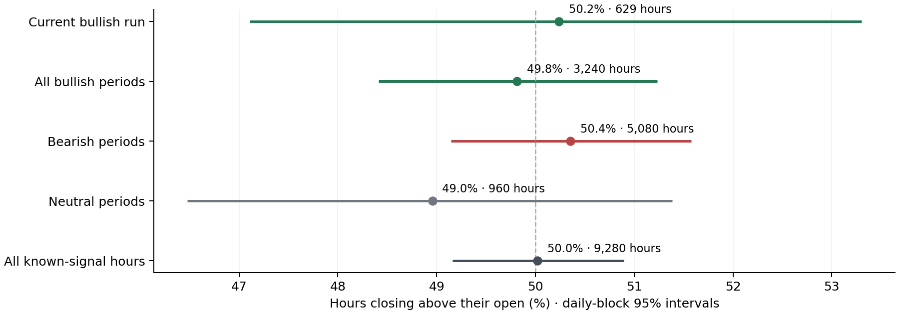
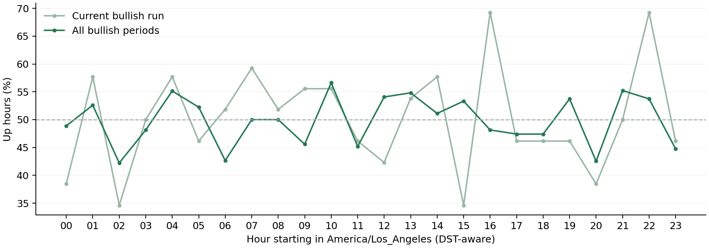

# Does BTC close up more often while the tracker is bullish?

Historical research · frozen at Sep 15, 2026 11:10 PDT · completed hours through Sep 15, 2026 11:00 PDT

## Answer

**Current bullish run:** BTC finished more often up than down: 316 up, 313 down, and 0 unchanged hours (50.24% up). The 95% interval includes 50%, so this sample does not clearly distinguish the up frequency from an even split.

**All recovered bullish periods:** BTC finished more often down than up: 1,614 up, 1,625 down, and 1 unchanged hours (49.81% up). The 95% interval includes 50%, so this sample does not clearly distinguish the up frequency from an even split.

Across all known-signal hours, the up frequency was 50.02%. These samples overlap: the current run is part of all bullish history. The study measures direction, not a Kalshi strike's win rate or profitability.

## Current bullish start

First report in the current verified run: **2026-08-20**. Onset classification: **verified flip**. Exact signal availability: Aug 20, 2026 05:38 PDT.

Consecutive original reports verify the change; the signal begins at trusted inbox receipt, after publication.

The first complete eligible hour began at Aug 20, 2026 06:00 PDT. The experiment carries the last verified state between reports. Hedgeye specifies publication on U.S. trading days; weekends and market holidays were also checked for exceptional reports in the complete email inventory. [Publication schedule and Trend definition](https://app.hedgeye.com/user-guides/bitcoin-trend-tracker)

## Primary: hourly close versus open

| Period | Hours / days | Up / down / flat | Up % | 95% interval | Mean / median return |
|---|---:|---:|---:|---:|---:|
| Current bullish run | 629 / 27 | 316 / 313 / 0 | 50.24% | 47.1–53.3% | 0.011% / 0.001% |
| All bullish periods | 3,240 / 145 | 1,614 / 1,625 / 1 | 49.81% | 48.4–51.2% | -0.005% / -0.002% |
| Bearish periods | 5,080 / 221 | 2,558 / 2,521 / 1 | 50.35% | 49.1–51.6% | -0.001% / 0.002% |
| Neutral periods | 960 / 50 | 470 / 490 / 0 | 48.96% | 46.5–51.4% | -0.008% / -0.005% |
| All known-signal hours | 9,280 / 390 | 4,642 / 4,636 / 2 | 50.02% | 49.2–50.9% | -0.003% / 0.000% |

Hours are assigned the most recent verified report available at their start. An intra-hour publication first applies to the next full hour. Unchanged hours remain in all percentage denominators. † indicates fewer than 30 hours or 10 distinct Pacific dates.

## Hour of day

Pacific clock hours include DST; repeated fall-back hours are separate UTC observations in the same clock-hour group. Full counts and intervals for every state/hour appear in the downloadable tables. These 24 comparisons are exploratory; the highest point is not a validated trading rule.

Each cell below shows **up percentage (number of hours)**.

| Hour starting PT | Current bullish | All bullish | Bullish 95% interval | Bearish | Neutral |
|---|---:|---:|---:|---:|---:|
| 00:00 | 38.5% (26) † | 48.9% (135) | 40.7–57.8% | 49.8% (211) | 37.5% (40) |
| 01:00 | 57.7% (26) † | 52.6% (135) | 44.4–60.7% | 51.4% (212) | 70.0% (40) |
| 02:00 | 34.6% (26) † | 42.2% (135) | 34.1–50.4% | 51.4% (210) | 60.0% (40) |
| 03:00 | 50.0% (26) † | 48.1% (135) | 40.0–56.3% | 54.0% (211) | 32.5% (40) |
| 04:00 | 57.7% (26) † | 55.1% (136) | 47.1–63.2% | 53.8% (212) | 50.0% (40) |
| 05:00 | 46.2% (26) † | 52.2% (134) | 44.0–60.4% | 49.8% (215) | 35.0% (40) |
| 06:00 | 51.9% (27) † | 42.6% (136) | 34.6–50.7% | 48.8% (213) | 52.5% (40) |
| 07:00 | 59.3% (27) † | 50.0% (136) | 41.9–58.1% | 56.1% (212) | 52.5% (40) |
| 08:00 | 51.9% (27) † | 50.0% (136) | 41.9–58.8% | 47.6% (212) | 37.5% (40) |
| 09:00 | 55.6% (27) † | 45.6% (136) | 37.5–53.7% | 50.7% (211) | 42.5% (40) |
| 10:00 | 55.6% (27) † | 56.6% (136) | 48.5–64.7% | 54.0% (211) | 47.5% (40) |
| 11:00 | 46.2% (26) † | 45.2% (135) | 37.0–53.3% | 47.4% (211) | 50.0% (40) |
| 12:00 | 42.3% (26) † | 54.1% (135) | 45.9–62.2% | 53.1% (211) | 47.5% (40) |
| 13:00 | 53.8% (26) † | 54.8% (135) | 45.9–63.0% | 53.6% (211) | 52.5% (40) |
| 14:00 | 57.7% (26) † | 51.1% (135) | 42.2–59.3% | 59.9% (212) | 57.5% (40) |
| 15:00 | 34.6% (26) † | 53.3% (135) | 45.2–61.5% | 37.7% (212) | 45.0% (40) |
| 16:00 | 69.2% (26) † | 48.1% (135) | 40.0–56.3% | 49.5% (212) | 57.5% (40) |
| 17:00 | 46.2% (26) † | 47.4% (135) | 39.3–56.3% | 50.9% (212) | 60.0% (40) |
| 18:00 | 46.2% (26) † | 47.4% (135) | 38.5–55.6% | 45.3% (212) | 62.5% (40) |
| 19:00 | 46.2% (26) † | 53.7% (134) | 45.5–61.9% | 43.9% (212) | 37.5% (40) |
| 20:00 | 38.5% (26) † | 42.5% (134) | 34.3–50.7% | 50.5% (212) | 42.5% (40) |
| 21:00 | 50.0% (26) † | 55.2% (134) | 47.0–63.4% | 45.5% (211) | 37.5% (40) |
| 22:00 | 69.2% (26) † | 53.7% (134) | 45.5–61.9% | 51.7% (211) | 60.0% (40) |
| 23:00 | 46.2% (26) † | 44.8% (134) | 36.6–53.0% | 52.1% (211) | 47.5% (40) |

## Position within the published range

Opening Coinbase price is compared with the tracker range known at that hour's start. Lower-half includes both the lower boundary and midpoint; upper-half includes the upper boundary. This comparison uses Coinbase spot prices against the published Hedgeye range, whose exact underlying feed is not assumed identical.

All recovered bullish periods:

| Period | Hours / days | Up / down / flat | Up % | 95% interval | Mean / median return |
|---|---:|---:|---:|---:|---:|
| Below lower range | 332 / 34 | 163 / 169 / 0 | 49.10% | 43.8–54.4% | 0.001% / -0.007% |
| Lower half | 1,231 / 82 | 612 / 619 / 0 | 49.72% | 47.6–51.9% | -0.013% / -0.003% |
| Upper half | 1,390 / 96 | 700 / 689 / 1 | 50.36% | 47.8–52.9% | -0.002% / 0.000% |
| Above upper range | 287 / 31 | 139 / 148 / 0 | 48.43% | 43.2–53.5% | 0.013% / -0.006% |

Current bullish run, using the same fixed range zones:

| Period | Hours / days | Up / down / flat | Up % | 95% interval | Mean / median return |
|---|---:|---:|---:|---:|---:|
| Below lower range † | 2 / 2 | 2 / 0 / 0 | 100.00% | 100.0–100.0% | 0.316% / 0.316% |
| Lower half | 306 / 19 | 152 / 154 / 0 | 49.67% | 45.8–53.8% | 0.005% / -0.002% |
| Upper half | 274 / 21 | 138 / 136 / 0 | 50.36% | 45.0–55.4% | 0.001% / 0.003% |
| Above upper range † | 47 / 6 | 24 / 23 / 0 | 51.06% | 32.1–61.0% | 0.098% / 0.018% |

Bullish hours with unavailable range boundaries: 0. They remain in the primary direction count and are excluded only from the range table.

Very small samples are especially limited: an all-up sample can produce a 100–100% resampling interval and cannot establish certainty about future hours. Other signal states and the combined sample are included in statistics.csv.

## Check 1: close versus previous hourly close

Only exactly consecutive candles qualify.

| Period | Hours / days | Up / down / flat | Up % | 95% interval | Mean / median return |
|---|---:|---:|---:|---:|---:|
| Current bullish run · previous close | 629 / 27 | 316 / 313 / 0 | 50.24% | 47.2–53.4% | 0.012% / 0.001% |
| All bullish periods · previous close | 3,239 / 145 | 1,615 / 1,624 / 0 | 49.86% | 48.5–51.3% | -0.004% / -0.002% |
| Bearish periods · previous close | 5,079 / 221 | 2,559 / 2,520 / 0 | 50.38% | 49.1–51.6% | -0.002% / 0.002% |
| Neutral periods · previous close | 960 / 50 | 471 / 489 / 0 | 49.06% | 46.6–51.5% | -0.008% / -0.005% |
| All known-signal hours · previous close | 9,278 / 390 | 4,645 / 4,633 / 0 | 50.06% | 49.2–51.0% | -0.003% / 0.000% |

## Check 2: official Kalshi settlement versus previous hourly settlement

Published finalized KXBTCD expiration values are the official final-minute BRTI averages. Each event contributes one observation after agreeing strike values are deduplicated. Only observations exactly one hour apart qualify. Signal selection occurs at the earlier settlement time.

| Period | Hours / days | Up / down / flat | Up % | 95% interval | Mean / median return |
|---|---:|---:|---:|---:|---:|
| Current bullish run · settlement | 612 / 27 | 305 / 307 / 0 | 49.84% | 46.3–53.3% | 0.011% / -0.002% |
| All bullish periods · settlement | 2,588 / 139 | 1,285 / 1,303 / 0 | 49.65% | 48.0–51.3% | -0.005% / -0.002% |
| Bearish periods · settlement | 4,289 / 214 | 2,138 / 2,151 / 0 | 49.85% | 48.5–51.2% | -0.003% / -0.001% |
| Neutral periods · settlement | 616 / 45 | 312 / 304 / 0 | 50.65% | 47.3–54.1% | 0.002% / 0.005% |
| All known-signal hours · settlement | 7,493 / 387 | 3,735 / 3,758 / 0 | 49.85% | 48.8–50.9% | -0.003% / -0.001% |

This check measures change between settlement averages. It does not say whether buying Yes on any particular listed dollar strike would have won.

Because the Kalshi archive covers fewer hours, the comparison below uses **only identical hourly intervals available from both sources**. Candle open→close and settlement-average changes remain different definitions.

| Period | Same hours | Coinbase open→close up | BRTI settlement change up | Direction agrees |
|---|---:|---:|---:|---:|
| Current bullish run | 612 | 50.00% | 49.84% | 96.57% |
| All bullish periods | 2,583 | 49.71% | 49.67% | 96.17% |
| Bearish periods | 4,284 | 49.88% | 49.86% | 96.69% |
| Neutral periods | 616 | 49.68% | 50.65% | 98.05% |
| All known-signal hours | 7,483 | 49.81% | 49.86% | 96.62% |

## Coverage and limitations

- Coinbase interval: 2025-07-28T00:00:00Z to 2026-09-15T18:00:00Z (UTC, end exclusive for hour starts).
- 9,954 expected hours; 9,944 valid candles; 10 missing/rejected hours.
- 9,280 hours with usable signal timing; 664 observed hours excluded for unknown signal. Missing prices are never filled.
- 8,350 finalized hourly settlement observations yield 8,103 consecutive-hour changes; 7,493 have usable signal timing.
- Settlement gaps include unlisted hours and 99 events excluded by the collector for invalid or incomplete published settlement evidence. Their prices are not reconstructed from contract outcomes or nearby strikes.
- The signal archive is incomplete. Missing source tables, missing timestamps, and unverified publication-calendar gaps are exclusions, not neutral signals.
- Explicit signal interruptions cover August 6, 2025 (unavailable original image), October 6, 2025 (missing BTC table), and June 4–29, 2026 (missing trusted receipt times or reports). Exact boundaries and excluded hours are preserved in the coverage export.
- 95% intervals resample whole Pacific days with replacement (10,000 replicates; seed 20260915), preserving within-day dependence. They do not eliminate dependence across days, selection bias from archive gaps, or the limited number of independent signal regimes.
- This tests an hourly implication of an intermediate-term Trend signal, which Hedgeye describes as a horizon of three months or more. It does not evaluate the signal's intended multi-month performance.
- Range and hour-of-day breakdowns are descriptive, without multiple-comparison claims. Returns are simple price changes, without leverage, entry prices, fees, or transaction-cost assumptions.

## Files and reproduction

- [Hourly observations](hourly-observations.csv)
- [Signal history and source evidence](signal-history.csv)
- [All cohort/hour/range statistics](statistics.csv)
- [Consecutive official settlement changes](settlement-changes.csv)
- [Coverage exclusions](coverage-exclusions.json)
- [Machine-readable results](results.json)
- [Source and reproducibility manifest](manifest.json)
- [Reproduction instructions](REPRODUCE.md)

Run `python3 scripts/research/btc_hourly_bias.py` from the repository root to regenerate this report from saved evidence without network access. Collection commands and source reconstruction steps are in the reproduction instructions. Original evidence and normalized inputs are preserved under `source-signals/` and `source-prices/`.

Primary references: [Coinbase hourly candle definitions](https://docs.cdp.coinbase.com/exchange/reference/exchangerestapi_getproductcandles), [Kalshi Bitcoin settlement rules](https://assets.kalshi.com/contract_terms/BTC.pdf). Individual Hedgeye reports are linked in signal-history.csv.
