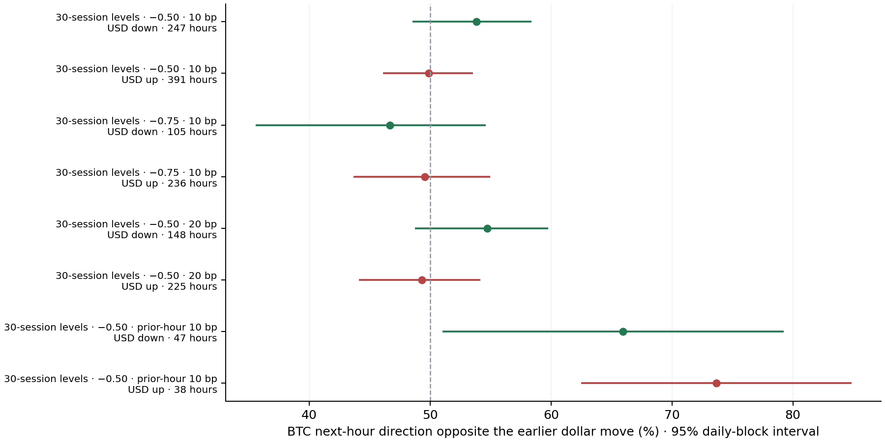

# Does the dollar improve BTC's hourly direction signal?

Historical research · same frozen BTC sample as the original study · completed BTC hours through September 15, 2026 11:00 PDT.

## Requested test

**During bullish Crypto Tracker periods, with BTC–DXY 30-session correlation at −0.50 or lower:**

When DXY fell at least 0.10%, BTC's following measured hour was up 53.85% of the time (247 hours on 25 Pacific dates; 95% interval 48.5–58.4%).

When DXY rose at least 0.10%, BTC's following measured hour was down 49.87% of the time (391 hours on 32 Pacific dates; 95% interval 46.1–53.5%).

These are exploratory conditional frequencies. An interval containing 50% does not distinguish the opposite-direction frequency from an even split. An apparent difference from 50% is not proof of improvement: the same-correlation baseline and its paired difference interval are shown below. Variations were examined together and are not independent confirmations or a validated trading strategy.

**The stronger pattern was a 0.10% dollar move within one hour**, keeping the same ≤ −0.50 daily-level correlation: BTC subsequently closed up 66.0% after dollar declines (47 hours), and down 73.7% after dollar rises (38 hours). This is a small, concentrated sample: only 6 qualifying hours were before February 20, 2026. It is a candidate for further testing, not established predictive performance.

## What the filters mean

- **Dollar:** DXY cash index, Yahoo symbol DX-Y.NYB, matching the dashboard's current reference. This is not a futures contract, ETF, or broad trade-weighted dollar series.
- **10 basis points = 0.10%**, measured from the latest available completed DXY daily close to the latest eligible hourly close. Separate variants use 5 bp, 20 bp, or the last one-hour move. This conservative historical reference may differ from a live quote's displayed daily change.
- **Correlation ≤ −0.50:** −0.70 qualifies; −0.30 does not. The main calculation matches the dashboard's Pearson correlation of daily **price levels**, over 30 aligned sessions. It is rebuilt using only completed observations; it is not an archived screenshot of the dashboard's displayed correlation. The 15-session and hourly-return versions are separately labeled.
- **BTC outcome:** the subsequent measured Coinbase hour's close versus open. The tracker state is the state known when that hour began. Up, down and unchanged prices all remain in the percentage denominator.
- **Conservative timing:** use a completed dollar hour that ended one hour before the BTC hour begins, adding one hour for data availability. For BTC's 10:00–11:00 interval, the dollar observation ends at 09:00. Daily DXY data wait until the next New York midnight plus one hour; daily BTC data wait until the next UTC midnight plus one hour. Correlations wait for both bars. ICE's weekday index calculation extends past 17:00 New York, so a 17:00 gate is unsuitable for the final daily index close.
- **Session gaps:** no new hourly dollar observation means no qualifying BTC hour. Dollar prices are never filled across closures or missing data. The prior daily close remains only a disclosed comparison reference.

## Main result by tracker state

30-session daily-level correlation ≤ −0.50; dollar move from latest available daily close ≥10 bp in either direction. “BTC opposite dollar” means BTC up after dollar down, or BTC down after dollar up.

| Tracker period / dollar move | Hours / days | BTC up / down / flat | BTC opposite dollar | 95% interval | Mean / median BTC return |
|---|---:|---:|---:|---:|---:|
| Current bullish run / down ≥10 bp † | 96 / 9 | 55 / 41 / 0 | up: 57.29% | 51.7–61.6% | 0.054% / 0.043% |
| Current bullish run / up ≥10 bp | 117 / 11 | 57 / 60 / 0 | down: 51.28% | 45.9–57.1% | -0.025% / -0.009% |
| All bullish periods / down ≥10 bp | 247 / 25 | 133 / 114 / 0 | up: 53.85% | 48.5–58.4% | 0.032% / 0.026% |
| All bullish periods / up ≥10 bp | 391 / 32 | 196 / 195 / 0 | down: 49.87% | 46.1–53.5% | -0.000% / 0.000% |
| Bearish periods / down ≥10 bp | 268 / 26 | 132 / 136 / 0 | up: 49.25% | 44.1–53.8% | -0.002% / -0.005% |
| Bearish periods / up ≥10 bp | 205 / 26 | 94 / 111 / 0 | down: 54.15% | 48.0–60.0% | -0.069% / -0.041% |
| Neutral periods / down ≥10 bp † | 29 / 4 | 13 / 16 / 0 | up: 44.83% | 33.3–60.0% | 0.049% / -0.061% |
| Neutral periods / up ≥10 bp † | 1 / 1 | 1 / 0 / 0 | down: 0.00% | — | 0.094% / 0.094% |
| All known-signal hours / down ≥10 bp | 544 / 52 | 278 / 266 / 0 | up: 51.10% | 47.6–54.5% | 0.016% / 0.006% |
| All known-signal hours / up ≥10 bp | 597 / 59 | 291 / 306 / 0 | down: 51.26% | 48.0–54.5% | -0.024% / -0.009% |

† Fewer than 30 hours or 10 distinct Pacific dates. Several hours can share the same daily correlation and dollar condition, so the hour count overstates the number of independent opportunities.

## Variations during all bullish periods

The baseline includes the same tracker state, correlation rule, source coverage and indicator availability, without restricting the dollar's direction or minimum move. Difference is the filtered opposite-direction frequency minus that baseline, in percentage points. The difference interval resamples both overlapping groups together by day.

| Variation / USD move | Hours / days | BTC opposite USD | 95% interval | Same-correlation baseline | Difference (pp) | 95% difference interval |
|---|---:|---:|---:|---:|---:|---:|
| 30-session levels · −0.50 · 10 bp / down | 247 / 25 | 53.85% | 48.5–58.4% | 50.26% | 3.58 | -0.8–7.8 |
| 30-session levels · −0.50 · 10 bp / up | 391 / 32 | 49.87% | 46.1–53.5% | 49.74% | 0.13 | -3.4–3.7 |
| 15-session levels · −0.50 · 10 bp / down | 193 / 26 | 52.85% | 46.3–59.3% | 48.91% | 3.94 | -1.7–10.1 |
| 15-session levels · −0.50 · 10 bp / up | 382 / 34 | 51.57% | 47.9–55.4% | 51.09% | 0.48 | -2.9–4.0 |
| 30-session levels · −0.75 · 10 bp / down | 105 / 11 | 46.67% | 35.6–54.6% | 49.68% | -3.01 | -13.5–4.5 |
| 30-session levels · −0.75 · 10 bp / up | 236 / 18 | 49.58% | 43.7–55.0% | 50.32% | -0.74 | -5.8–4.0 |
| 30-session levels · −0.50 · 5 bp / down | 320 / 31 | 53.12% | 48.2–57.5% | 50.26% | 2.86 | -1.4–6.8 |
| 30-session levels · −0.50 · 5 bp / up | 462 / 41 | 51.73% | 49.0–54.5% | 49.74% | 1.99 | -0.6–4.7 |
| 30-session levels · −0.50 · 20 bp / down | 148 / 17 | 54.73% | 48.8–59.7% | 50.26% | 4.47 | -1.2–9.7 |
| 30-session levels · −0.50 · 20 bp / up | 225 / 23 | 49.33% | 44.1–54.1% | 49.74% | -0.41 | -5.4–4.3 |
| 120-hour returns · −0.50 · 10 bp / down † | 7 / 1 | 28.57% | — | 35.29% | -6.72 | — |
| 120-hour returns · −0.50 · 10 bp / up † | 25 / 2 | 60.00% | 57.9–66.7% | 64.71% | -4.71 | -6.8–-2.1 |
| 30-session levels · −0.50 · prior-hour 10 bp / down | 47 / 31 | 65.96% | 51.0–79.2% | 50.37% | 15.59 | 1.7–29.1 |
| 30-session levels · −0.50 · prior-hour 10 bp / up | 38 / 24 | 73.68% | 62.5–84.8% | 49.63% | 24.05 | 12.2–36.5 |

The downloaded statistics additionally include dollar-only controls, all tracker states, and an earlier/later split at February 20, 2026. That split is descriptive and does not constitute an independent holdout test. Of the 85 bullish one-hour-move observations, 57 came from the two busiest months (2026-04, 2026-05). Price-level correlations can reflect shared trends; the 120-hour-return variant checks a different definition and has very little qualifying data here.

## Official settlement check for the one-hour move

Using the same selected hours during bullish tracker periods, and the original study's verified consecutive BRTI settlement averages:

| Prior dollar move | Paired hours | BTC opposite dollar: BRTI | 95% interval | Coinbase on identical hours |
|---|---:|---:|---:|---:|
| Down ≥10 bp | 44 | 63.64% up | 47.6–79.1% | 65.91% up |
| Up ≥10 bp | 38 | 68.42% down | 56.8–80.0% | 73.68% down |

The settlement check points in the same direction with weaker frequencies. It measures change between consecutive official averages, not whether a particular dollar-strike contract wins. Missing settlement hours are excluded; full counts for this and the daily-move filter are downloadable.

## Coverage and uncertainty

- Original BTC sample: 9,944 completed observed hours, including 9,280 with usable tracker timing.
- Hours with an eligible DXY observation: 6,762; source, timing and feature exclusions are counted separately in coverage.json.
- All-bullish hours eligible for the main test before the correlation filter: 2,184; after the negative-correlation filter: 957.
- 95% percentile intervals use 10,000 resamples of whole Pacific days, fixed seed 20260915 with deterministic group-specific seeds. They preserve within-day dependence but do not remove cross-day dependence, archive selection effects, or multiple-comparison risk. Very small all-up/all-down samples can yield degenerate intervals without implying certainty.
- Daily/history values are the provider's currently retrievable historical records. The one-hour lag is a conservative timing convention, not proof of the original data vendor's precise publication time or absence of later corrections.
- This measures historical price direction. It does not simulate a Kalshi strike payout, order execution, or profits.

## Files and reproduction

- [Every BTC hour with dollar indicators and exclusions](hourly-observations.csv)
- [All variation and control statistics](statistics.csv)
- [Official settlement checks](settlement-checks.csv)
- [Coverage and excluded observations](coverage.json)
- [Source and calculation manifest](manifest.json)
- [Repeat the experiment locally](REPRODUCE.md)
- [Original BTC study](../btc-hourly-bias-experiment/report.html)

Dollar definition and timing: [ICE U.S. Dollar Index](https://www.ice.com/forex/usdx), [ICE index calculation-hours notice](https://www.ice.com/publicdocs/equity_indices/notices/DXY_ICE_FX_Indices_Methodology_Updates_20210311.pdf). Historical provider: [Yahoo DXY history](https://finance.yahoo.com/quote/DX-Y.NYB/history/). The source archive preserves raw responses, timestamps and hashes.
