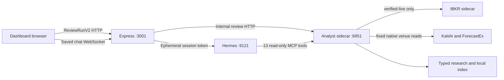

# The Analyst

The Analyst combines durable, deterministic review reports with a separate cited follow-up chat. The two paths deliberately do not share orchestration: ReviewRunV2 is owned by Express and the Analyst sidecar, while Hermes is used only for saved general-chat transport and optional bounded follow-up context.

## Runtime boundary

The browser never receives the Analyst service token or Hermes token. Hermes receives no AWS credentials. Its fixed MCP allowlist contains:

- `get_research_coverage`
- `get_briefing_packet`
- `get_market_situation_context`
- `search_research`
- `get_research_source`
- `get_research_page_image`
- `get_portfolio_context`
- `get_balance_context`
- `get_live_market_snapshot`
- `get_prediction_market_snapshot`
- `get_market_history`
- `get_company_fundamentals`
- `get_macro_series`

The former Portfolio packet tools are not registered with MCP, are absent from the Hermes profile, and are rejected by the gateway allowlist. Terminal, filesystem, browser, web, memory, delegation, scheduling, execution, image, and computer-control toolsets remain disabled for Hermes.

## Codex-style conversation model

A fresh Analyst mount opens on a blank landing canvas with a ready composer and three centered actions:

1. **Portfolio Review**
2. **Predictive Markets Review**
3. **Balance Review**

There are no permanent top actions, Quick Reviews section, fixed review rows, automatic last-conversation selection, or attempt picker. **New Chat** returns to this landing without creating an empty row. The first typed message creates one ordinary Hermes conversation; a review click creates one UUID-backed durable review conversation. Both appear in the same sidebar, grouped by their immutable creation date in the browser's local timezone. Activity and completion never reorder rows.

Selecting a sidebar row is the only operation that changes the visible transcript. Late HTTP responses, stream frames, reconnects, list refreshes, and background completions update their owning conversation only. A running conversation has one subtle loader in its transcript and a static **Running** sidebar status. Internal prompts, tool output, evidence counters, and progress cards are not rendered.

Only one review of a given kind may be active at once. A repeated same-kind click opens that existing running conversation; Portfolio, Predictive Markets, and Balance reviews may otherwise run concurrently. A terminal failed or interrupted attempt remains in the same conversation with one normalized error and **Retry with fresh data**. Retry appends an immutable attempt using new verified-live acquisition. A terminal conversation may be archived from the sidebar without deleting its runs, reports, citations, or evidence; an active conversation cannot be archived.

The contracts are:

| Review | Deterministic content |
|---|---|
| Portfolio Review | Executive snapshot; verified NLV, P/L, and mark coverage; gross/net and long/short exposure; leverage, concentration, and boundary exceptions; exact full-book typed current/prior research reconciliation; held conflicts and lifecycle changes; material market/macro context; changes from the newest accepted v2 baseline; coverage and data-quality exceptions. Every holding is reconciled internally, while only material exceptions are displayed. |
| Predictive Markets Review | Exactly one row for every fixed monitored asset and venue; event and contract identity; expiration, resolver, threshold, native book, and settlement state; verified live reference; current Risk Range/Trade/Trend fields; held event-contract exposure from IBKR; and compact settlement, resolver, catalog, quote, or coverage exceptions. It contains no broad scan, listed-options inventory, trade recommendation, sizing, or execution instruction. |
| Balance Review | Verified account summary; cash, NLV, buying power, available funds, excess liquidity, margin health, settlement, exposure and leverage; securities/commodity cash floors, collateral and policy buffers, add-long room or trim requirement; open-order and same-day effects; interest and borrow evidence; forecasts, actuals, residuals, recent postings; and compact data exceptions. It does not duplicate the holdings inventory. |

Predictive Markets Review has a code-owned allowlist. `auto` and alternate venues are prohibited:

- Silver → ForecastEx
- Gold → Kalshi
- WTI → Kalshi
- Brent → Kalshi
- Bitcoin → Kalshi
- S&P 500 → ForecastEx

One unavailable asset produces one unavailable row and does not remove verified siblings.

## ReviewRunV2 contract

`ReviewRunV2` stores immutable attempts in `analyst_reviews_v2.sqlite3`. `analyst_review_conversations_v1` owns the UUID conversation, review kind, stable title, unique initial request ID, creation/update timestamps, optional Hermes stored-session link, and archive timestamp. Each attempt records:

- `runId`, `attempt`, stable `conversationId`, compatibility `sessionId`, `requestId`, `reviewKind`, and an optional `previousRunId`;
- `state`: `queued`, `running`, `succeeded`, `failed`, or `cancelled`;
- `phase`: `acquiring`, `rendering`, `summarizing`, or `terminal`;
- terminal `outcome`: `ready`, `partial`, or `blocked`;
- dependencies, timestamps, content-addressed source fingerprints, citations, normalized sections, deterministic Markdown, an optional summary, and one normalized error.

The shared coordinator uses injected Portfolio, Prediction, Balance, research, and summary-provider boundaries. Production and integration tests execute the same coordinator and renderers. Every acquisition checkpoint is persisted immediately. A later renderer, fingerprint, persistence, or optional-summary fault cannot erase completed evidence or turn each section into a duplicate source failure.

Canonical hashing lives in one imported helper in `review_runs_v2.py`; no coordinator code references an undeclared `sha256`. A startup canary executes hashing and deterministic rendering. `/healthz` exposes the canary as `reviewCoordinator`. An unexpected coordinator failure latches new review readiness off until the sidecar restarts, without disabling saved-chat navigation. On restart, any orphaned queued/running attempt is closed once as `REVIEW_PROCESS_RESTARTED`, its checkpoints remain intact, and it becomes retryable instead of loading forever.

The initial request ID is idempotent. A second request while that review kind is active returns the existing active conversation; after it becomes terminal, a new launch creates a new UUID conversation. A retry is idempotent within its conversation, creates the next immutable attempt with `previousRunId`, and performs a fresh live acquisition. Earlier attempts are never rewritten or treated as current.

On first startup after this change, every legacy `review:<kind>` fixed-shell run is transactionally moved to its own deterministic UUID conversation. A pre-migration SQLite backup is written once. Run IDs, reports, citations, evidence fingerprints, timestamps, retry lineage, and accepted-baseline lineage are preserved, and rerunning the migration makes no further changes. Ordinary Hermes chats are not migrated.

Only a fully verified, `ready` Portfolio Review becomes the automatic comparison baseline. `no_baseline` and verified-none results are successful outcomes. Partial, blocked, incomplete, or transport-failed attempts never become baselines and never prove the absence of a finding.

## Acquisition and bounded synthesis

Portfolio acquisition concurrently starts one fresh portfolio snapshot, exact research coverage/manifests, exact current documents, and Market Situation context. It then reads exact current/prior typed security intelligence, the complete typed research-event universe, and the complete current-date Alpha set. Server code performs reconciliation, alias control, lifecycle precedence, exposure math, concentrations, changes, and coverage status. Semantic top-k search is never used to prove completeness.

Balance acquisition reads current balance and portfolio channels independently. P/L remains single-flight per account: concurrent callers share one fresh subscription, no caller cancels another, and cancellation occurs only after the shared request settles. A P/L failure makes only P/L-dependent fields partial while verified marks and balances remain usable.

The deterministic report is complete without Hermes. Optional synthesis, when enabled, receives only normalized verified findings: one isolated call, no tools, no packet retrieval, at most 32 KB of input, at most 1,200 output tokens, and a 12-second timeout. Failure or timeout omits the optional summary and does not fail the deterministic report.

Total server deadlines are fixed:

- Balance Review: 20 seconds
- Predictive Markets Review: 30 seconds
- Portfolio Review: 75 seconds

Provider failures settle as partial or blocked within the applicable bound. They do not start retry waves or extend a run indefinitely.

## Strict live-data rules

Current trading values must come from a fresh, verified provider response for the current attempt. Stale, retained, delayed, cached, cache-only, inferred, portfolio-derived, mock, seed, historical, or fallback values never substitute for a failed current read.

IBKR is the only source of live portfolio/account values and held event-contract exposure. Direct venue books must match the fixed requested venue and pass the current book gate. Research history and accepted v2 baselines may support dated comparisons only; they can never satisfy a new run's current-data gate. Every independently verified sibling stays available when another dependency fails.

## HTTP and browser recovery

The conversation protocol is:

- `GET /api/analyst/review-conversations?limit=&cursor=&q=` returns compact, creation-ordered summaries only;
- `POST /api/analyst/review-conversations` with `{reviewKind, requestId}` returns HTTP 202 for a new conversation or HTTP 200 for the existing same-kind active conversation;
- `GET /api/analyst/review-conversations/:id` returns the selected display projection;
- `GET /api/analyst/reviews/:runId/status` returns only the tiny active-run status contract;
- `POST /api/analyst/review-conversations/:id/retries` with a new request ID and previous run ID appends an attempt;
- `DELETE /api/analyst/review-conversations/:id` archives a terminal sidebar row;
- `PUT /api/analyst/review-conversations/:id/hermes-session` links or compare-and-swaps the optional follow-up session.

List and status payloads never contain report Markdown, sections, evidence, dependencies, fingerprints, citations, or diagnostics. Detailed report content is fetched when its conversation is selected or reaches terminal state; source details are loaded only when opened. The retired fixed-shell launch route returns HTTP 410. Older run endpoints remain compatibility-only and are not used by the new UI.

Legacy WebSocket `gm`, `retry_gm_review`, `start_review`, and `retry_review` actions return stable retired-protocol errors before Hermes is contacted. Hermes WebSockets remain available for saved general chat, session history, title changes, interruption, and follow-ups.

Only active review IDs are polled, through their tiny status endpoint. Polling stops at terminal state, backs off to five seconds after failures, and all timers pause while Analyst is hidden. There is no idle review polling. History is cursor-paginated. Only the selected transcript is mounted; citation/source panels mount lazily.

Streaming buffers are keyed by conversation and committed at roughly 150 ms. The unfinished tail renders as plain text; Markdown is parsed once when the message becomes terminal. Navigating away neither stops the turn nor exposes its partial tail in another transcript. Completion updates the correct background row without changing `aria-current`.

The Analyst WebSocket exists only while its retained surface is visible. After a Hermes restart or update it reconnects with jittered 0.5/1/2/5-second backoff, refreshes compact history, and resumes the selected stored session. An interrupted Hermes generation clears its loader, inserts one normalized interruption message, and enables the composer after reconnection. Intentionally hiding the surface does not fabricate an interruption. Server-owned reviews continue independently throughout.

Launching a deterministic review never warms Hermes. The first follow-up performs one gateway operation that creates or resumes a hidden Hermes session, attaches bounded `ReviewContextV2`, submits the visible prompt, and persists the stored-session link. If an update kills a linked empty session before Hermes persisted it, the gateway validates the link, creates a replacement, and compare-and-swaps the stored ID. Managed review follow-up sessions are excluded from ordinary chat history so they cannot produce duplicate rows. Deterministic reports, evidence archives, and traces never enter Hermes history.

The Analyst is wrapped in a React error boundary so a render or lazy-chunk fault cannot blank the rest of the dashboard.

## Readiness and rollout

`/api/analyst/status` reports separate readiness for:

- `sessionTransport`;
- `reviewCoordinator`;
- `portfolioReview`;
- `predictionMarketsReview`;
- `balanceReview`.

Hermes failure affects only saved general chat and follow-ups. Each review kind has an independent server flag:

- `ANALYST_BALANCE_REVIEW_ENABLED`
- `ANALYST_PREDICTION_MARKETS_REVIEW_ENABLED`
- `ANALYST_PORTFOLIO_REVIEW_V2_ENABLED`

The intended rollout validates Balance first, Predictive Markets second, and Portfolio last. GM and every legacy review launch remain retired throughout.

Express uses five-second dependency probes with last-known-good hysteresis: one short probe miss inside the grace window does not disable otherwise healthy controls, while a confirmed second miss fails closed. The Hermes process is launched as the isolated `analyst` profile with explicit process identity, tool-progress frames disabled, and no custom `max_turns` ceiling. **New Chat** is purely local navigation to the blank canvas; the first prompt is request-correlated and creates/submits the deterministic-title Hermes conversation in one operation.

## Verification

`npm run test:analyst` runs the Python undefined-name check, coordinator/provider tests, gateway and Express protocol tests, and React tests. Conversation tests cover blank landing, first-message creation, three launches, local-date grouping, stable ordering, background completion isolation, same-kind reuse, retries, archives, cursor pagination, compact payload budgets, hidden-idle traffic, stream scoping, terminal-only Markdown, restart recovery, migration reruns, and immutable evidence preservation. The deep Hermes contract verifies prompt streaming plus persisted and resumed MCP tool history while user-facing tool-progress frames remain disabled. The captured 54-position regression asserts zero packet calls, one bounded optional-summary call, one content-addressed copy of shared evidence, and no unbounded prompt growth. Prediction tests assert the exact six-asset venue allowlist and sibling isolation. IBKR lifecycle tests cover shared P/L acquisition. A production build and isolated browser smoke are required before adoption.
